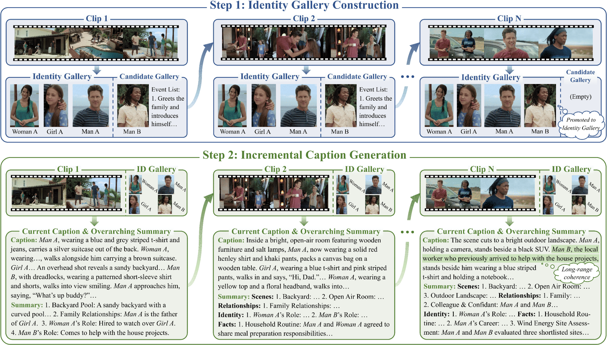

#  PIGEONS: Incremental Long-Video Captioning with <u>P</u>ersistent <u>I</u>dentity <u>G</u>allery and <u>E</u>volving <u>O</u>verarching <u>N</u>arrative <u>S</u>ummary

<p align="left">
  <a href="https://pigeons-captioner.github.io/"></a>
  <a href="https://huggingface.co/PIGEONS-Captioner/PIGEONS"></a>
  <a href="https://arxiv.org/abs/2610.xxxxx"></a>
</p>

---

## ✨ Overview
Detailed video captioning has become an essential semantic interface for multi-modal understanding and generation. While existing methods mainly target short videos, extending them to long videos remains challenging, primarily due to limited context windows of current video understanding models. A naive solution is to adopt segment-wise captioning followed by concatenation, yet this paradigm often suffers from *inconsistent subject references* and *fragmented long-range narratives*. To mitigate these issues, we introduce **PIGEONS**, an incremental long-video captioning model built upon a **Persistent Identity Gallery** and an **Evolving Overarching Narrative Summary**.

As illustrated in the figure below, before caption generation, PIGEONS scans the entire video to construct an identity gallery that captures key subjects along with their visual references, thereby providing a stable referential anchor. The model then performs clip-by-clip captioning conditioned on the persistent gallery and an evolving overarching narrative summary, which compactly maintains and updates essential long-range contextual information after each captioning step.

To enable these capabilities, we develop a three-stage training strategy that integrates supervised fine-tuning and reinforcement learning. Extensive experiments demonstrate that PIGEONS markedly improves long-video captioning performance, achieving superior accuracy, completeness, and subject referential consistency over existing methods, while maintaining competitive performance on short-video captioning.



## 🚀 Getting Started
Follow these simple steps to set up and run PIGEONS on your machine.

### 1. Clone the repository
First, clone the project and navigate into the directory:

```bash
git clone https://github.com/PIGEONS-Captioner/PIGEONS.git
cd PIGEONS
```

### 2. Set Up the Environment
Create and activate the Conda environment using `environment.yml`. It lists direct inference dependencies and includes FFmpeg; benchmark judge dependencies are installed separately as described under Benchmark evaluation below.

```bash
conda env create -f environment.yml
conda activate pigeons
```

### 3. Quick Usage

#### 3.1 Start the model service

In one terminal, specify the path to the PIGEONS model weights, which can be downloaded from [Hugging Face](https://huggingface.co/PIGEONS-Captioner/PIGEONS):

```bash
CUDA_VISIBLE_DEVICES=0,1 TP=2 PORT=12346 \
  bash quick_start/serve.sh /path/to/PIGEONS
```

#### 3.2 Generate captions

In a second terminal with the same environment:

```bash
python quick_start/inference.py \
  --video /path/to/video.mp4 \
  --host 127.0.0.1 --port 12346 \
  --output-dir outputs
```

For multiple videos, repeat `--video`:

```bash
python quick_start/inference.py \
  --video /path/to/first.mp4 \
  --video /path/to/second.mp4 \
  --host 127.0.0.1 --port 12346 \
  --workers 2 --output-dir outputs
```

The client splits the video, builds the global gallery across all clips, then generates the captions sequentially. Across-video concurrency is available, while clips within each video remain ordered.

### 3.3 Inspect the outputs

Each input receives a directory named `<video-stem>_<path-hash>` (with an optional dataset prefix). The hash keeps same-name videos in different directories separate. Under that directory:

| Output | Contents |
| --- | --- |
| `full_caption.txt` | Final clip captions joined in chronological order |
| `captions.json` | Ordered captions, cumulative summaries, and timings |
| `repository.json` | Fixed final gallery, candidate state, and reference image paths |
| `captions/` | Per-clip parsed and raw caption responses, or error records |
| `subject_repository/` | Gallery construction, frame/crop review, reference images, and interaction traces |
| `run.json` | Source video, ordered clips, and served model name |
| `summary.json` | Captioning completion, gallery status, counts, timings, and errors |

The output root also contains batch `summary.json` and, by default, a `clips/` cache. Results contain local paths; keep the output tree in place when inspecting reference images.

## ⚙️ Inference options and behavior

```bash
python quick_start/inference.py --help
```

| Option | Default | Meaning |
| --- | --- | --- |
| `--clip-seconds` | `120` | Initial target segment duration; cuts follow source keyframes |
| `--max-clip-seconds` | `125` | Maximum accepted clip duration |
| `--fps` | `2.0` | Requested video sampling rate, forwarded by the bundled server plugin |
| `--max-frames` | `240` | Video frame cap per model request |
| `--max-tokens` | `8192` | Maximum generated tokens per request |
| `--temperature` / `--top_k` / `--top_p` | `0.0` / `1` / `0.001` | Per-request decoding settings |
| `--seed` | `42` | Request seed |
| `--validation-retries` | `3` | Attempts for gallery response validation |
| `--max-review-rounds` | `5` | Additional gallery review rounds after the initial round |
| `--workers` | `1` | Concurrent videos; tune with server capacity |
| `--clip-dir` | `<output-dir>/clips` | Generated segment cache root |
| `--overwrite` | off | Regenerate this video's existing outputs |
| `--preserve-clips-on-rerun` | off | Keep reusable, validated split clips when rerunning |

Video frames use a maximum area of 262144 pixels. Videos are split at source keyframes using FFmpeg stream copy, retaining audio without re-encoding. The initial segment length is the ceiling of the video duration divided by the nominal segment count. If any clip exceeds the duration ceiling or the summed clip durations differ from the source by more than 5 seconds, the target is reduced to 95% (rounded down) and splitting is retried, for up to 10 attempts. Actual clip counts and durations depend on source keyframes. Cache reuse checks source metadata, settings, segment sizes, and durations.

Completed videos are skipped on a subsequent run. Use `--overwrite` when changing the checkpoint, source content, or generation settings. Incomplete videos restart from the beginning.

## 📏 Benchmark evaluation

Run all commands below from the repository root. Annotations are bundled in `eval_scripts/{capricorn,ugc,worldsense}/`; videos must be supplied separately. Text-only evaluation needs no model weights or GPU.

| Benchmark | Metrics | Default judge | Videos |
| --- | --- | --- | ---: |
| CapRiCorn-1K | Accuracy, Coverage, Referential Consistency | `gpt-4.1` | 1,000 |
| UGC-VideoCap | Audio, Visual, Details | `gpt-4.1` | 999 |
| WorldSense | Caption-based QA accuracy | `gemini-2.5-pro` | 1,662 (3,172 questions) |

### 1. Set up API keys for judge models

Set `OPENAI_API_KEY` for CapRiCorn/UGC and `GEMINI_API_KEY` for WorldSense in your environment. To use another judge, pass `--judge-model`; for an OpenAI-compatible service, also pass `--backend openai-compatible --base-url URL`. WorldSense also supports Vertex AI via `GOOGLE_GENAI_USE_VERTEXAI=true`, `GOOGLE_CLOUD_PROJECT`, `GOOGLE_CLOUD_LOCATION`, and Application Default Credentials.

### 2. Prepare predictions

If you already have benchmark predictions, skip to step 3. Otherwise, start the model service as described in Quick Usage, then generate and export captions. This example uses WorldSense; replace `worldsense` with `capricorn` or `ugc` for the other datasets.

```bash
python eval_scripts/prepare_manifest.py \
  --benchmark worldsense --video-root /path/to/worldsense/videos \
  --output eval_results/worldsense_manifest.jsonl

python eval_scripts/generate_captions.py \
  --manifest eval_results/worldsense_manifest.jsonl \
  --host 127.0.0.1 --port 12346 --workers 1 \
  --output-dir eval_results/worldsense_inference

python eval_scripts/prepare_predictions.py \
  --benchmark worldsense --manifest eval_results/worldsense_manifest.jsonl \
  --inference-dir eval_results/worldsense_inference \
  --output eval_results/worldsense_predictions.jsonl
```

### 3. Run evaluation

Append `--dry-run` first to validate inputs without judge API calls. Remove it to compute scores with your configured judge.

```bash
python eval_scripts/evaluate.py --benchmark capricorn \
  --predictions eval_results/capricorn_predictions.jsonl \
  --output-dir eval_results/capricorn --expected-count 1000

python eval_scripts/evaluate.py --benchmark ugc \
  --predictions eval_results/ugc_predictions.jsonl \
  --output-dir eval_results/ugc --expected-count 999

python eval_scripts/evaluate.py --benchmark worldsense \
  --predictions eval_results/worldsense_predictions.jsonl \
  --output-dir eval_results/worldsense --expected-count 1662
```

Results are saved as `metrics.json`, `run.json`, and judgement JSONL files. Rerunning resumes matching cached tasks; add `--retry-failed` to retry failures. Changed inputs, judge settings, or evaluator code require a new output directory. Exit code 1 / `complete: false` indicates failures; inspect and retry before reporting scores. Run only one evaluator per output directory.

## 📝 Citation

If you find our work helpful for your research, please consider giving a star ⭐ and citing our paper. We appreciate your support!

```bibtex
TODO
```